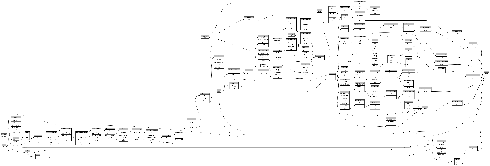

```
# AUTOGENERATED BY ECOSCOPE-WORKFLOWS; see fingerprint in README.md for details

```

```yaml
# fingerprint:
artifacts_sha256_basic: 7e3bbbe80b87ca6adbc8297d53cd51e387db8b84167945cdbe13b09693aca9d9
artifacts_sha256_strict: f3ab4090e12cce7cee8068bc4c4af947985f9e1b6d1ed66b3c5840a99ebd6b19
installed_requirements:
- channel: https://repo.prefix.dev/ecoscope-workflows/
  name: ecoscope-platform
  version: {version: ==2.28.0}
- channel: https://repo.prefix.dev/ecoscope-workflows-custom/
  name: ecoscope-workflows-ext-custom
  version: {version: ==0.1.5}
- channel: conda-forge
  name: pydeck
  version: {version: ==0.9.2}
- channel: https://repo.prefix.dev/ecoscope-workflows-custom/
  name: ecoscope-workflows-ext-eden
  version: {version: ==0.0.13}
params_sha256: 6845a272d138f6b7272016073a0bc778d0fb440d3eb8930f7d9e993ed1627fb6
spec_sha256: 1855e2e3c95e0fa11daae8e98544e66bf820d77b3b0155c8c0f89b35353b0022

```

# ecoscope-workflows-rubeho-community-engagement-workflow


